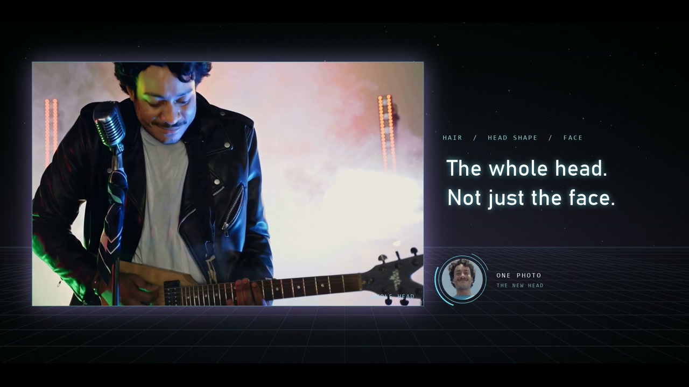
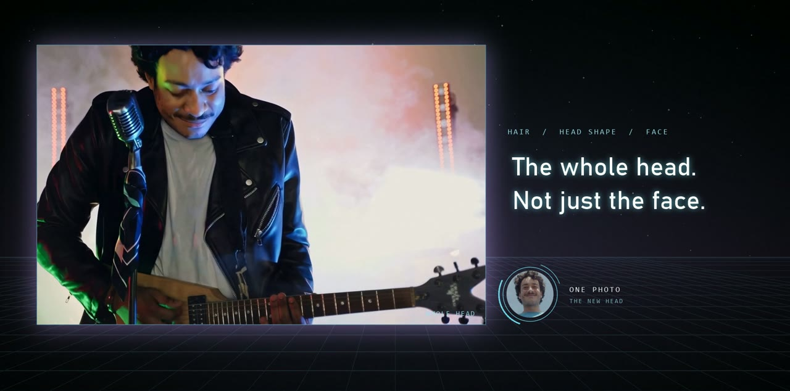
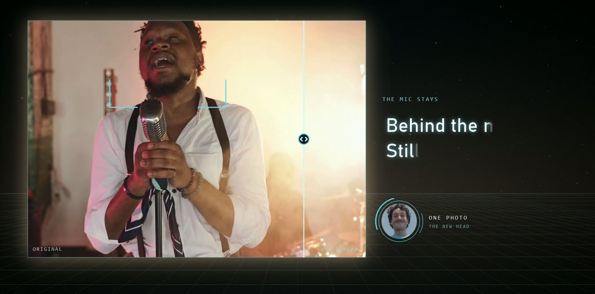
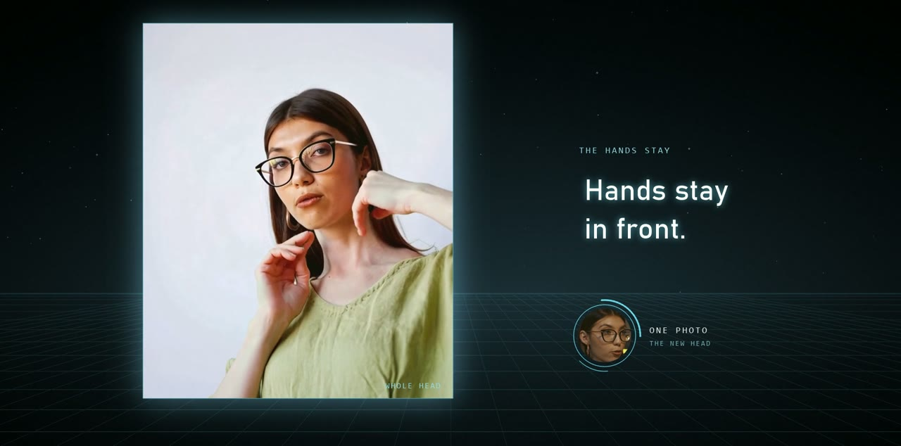
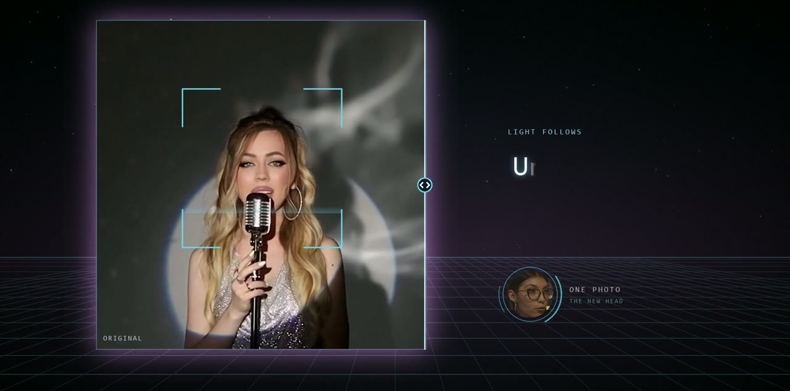
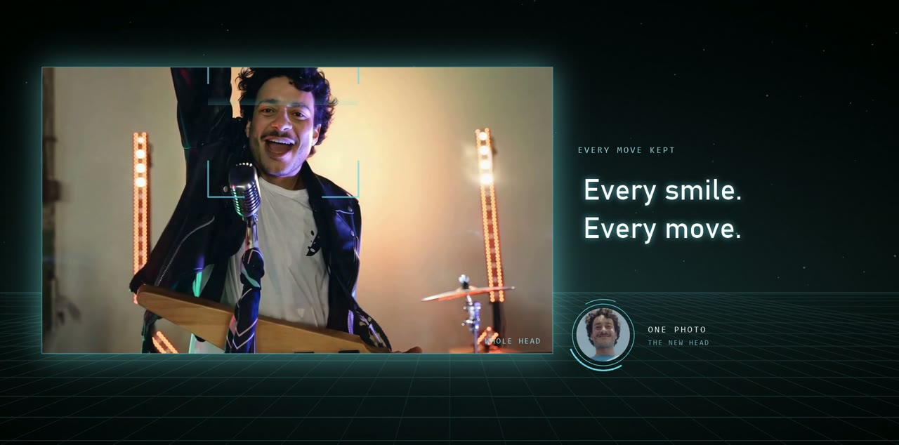
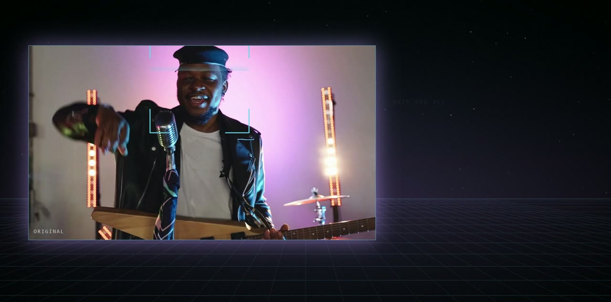

# NanoPocket · Video FaceSwap 2.5 – Headswap Fast

### One photo. Any video. The whole head, not just the face.

   

## 🎬 Demo video

▶️ **[Watch on YouTube](https://youtu.be/MgbQi_wJMl4)**

## ✨ About Video FaceSwap 2.5

Video FaceSwap 2.5 replaces one person you choose, in every frame of a video, with the face – or now the whole head – from a single reference photo. Everything else stays exactly as it was filmed, including the original sound. New in 2.5: Headswap Fast swaps hair, head shape and face about 40% faster and with about 35% fewer credits than Headswap Best.

- Whole head, not just the face: hair, head shape and face all come from one photo
- Headswap Fast: about 40% faster and about 35% fewer credits than Headswap Best
- Hands, mics and props stay in front of the new head
- The new head takes the light of the scene, even under coloured stage light
- You choose who changes; everyone else, the background and the sound stay as filmed
- Diffusion face enhancement, delivered at 1080p or 4K
- New accounts start with 100 free credits

## 🚀 Try it now

- **Try Video FaceSwap 2.5 Online: [swap-studio.onrender.com](https://swap-studio.onrender.com)**
- **Product page: [nanopocket.ai/facestudio-v](https://nanopocket.ai/facestudio-v)**

## 🖼 Highlights

<table><tr><td align="center" valign="top" width="50%"> <b>The whole head. Not just the face.</b></td><td align="center" valign="top" width="50%"> <b>Behind the mic. Still the new head.</b></td></tr></table>

<table><tr><td align="center" valign="top" width="50%"> <b>Hands stay in front.</b></td><td align="center" valign="top" width="50%"> <b>Under any stage light.</b></td></tr></table>

<table><tr><td align="center" valign="top" width="50%"> <b>Every smile. Every move.</b></td><td align="center" valign="top" width="50%"> <b>Anyone you choose.</b></td></tr></table>

## 🏢 About NanoPocket

NanoPocket builds generative AI creative tools for images, video and faces. Use them online in your browser, or as desktop apps that run 100% locally on your own GPU, so your data never leaves your machine. The suite covers video face swap and head swap, facial editing, virtual try-on, image generation and editing, image and video upscaling, and AI video generation.

## 🔗 Links

- **Website:** https://nanopocket.ai
- **Download:** https://nanopocket.ai/download
- **Hugging Face:** https://huggingface.co/Nanopocket-ai
- **YouTube:** https://www.youtube.com/@NanoPocket_ai
- **GitHub:** https://github.com/Nanopocket-ai
- **Contact:** tech@nanopocket.ai

---

AI-generated. Footage and faces are stock models. Use only faces you have the right to use.

© 2026 NanoPocket. All rights reserved. Synced automatically from https://nanopocket.ai.
